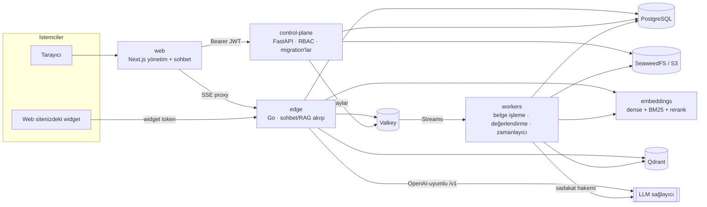

# Raggie

**Ekipler ve web siteleri için kendi sunucunuzda çalışan RAG sohbeti: belgelerinizi yükleyin, Türkçe ya da İngilizce kaynak gösterilmiş cevaplar alın, tüm yığını (isterseniz modeli de) kendi sunucularınızda çalıştırın.**

[](https://github.com/alicangunduz/raggie/actions/workflows/ci.yml)
[](LICENSE)
[](https://github.com/alicangunduz/raggie/releases)

[English README](README.md)

<p align="center"></p>

> **Durum: v0.1.0 Community Preview.** Çekirdek kullanılabilir durumda ve
> testlerle kapsanıyor; ancak performans rakamları, benchmark raporları
> yayımlanana kadar hedef niteliğindedir. Bkz. [Bilinen sınırlamalar](#bilinen-sınırlamalar).

Raggie, kendi belgelerinizin üzerine iki şey sunar:

- **Ekipleriniz için bir iç asistan:** departman bazlı çalışma alanları, rol
  tabanlı erişim, kaynağa geri bağlanan numaralı alıntılarla cevaplar.
- **Web siteniz için gömülebilir bir destek widget'ı:** tasarım gereği yönetim
  arayüzünden yalıtılmıştır.

Tamamlanan cevaplar, deneysel bir LLM hakemi tarafından getirilen kaynaklara
sadakat (faithfulness) ve alıntı kalitesi açısından denetlenir; düşük puanlı
konuşmalar incelenmek üzere işaretlenir. Hakemin doğruluğu henüz ölçülmedi.

## Ekran görüntüleri

| | |
|---|---|
|  |  |
| **Kaynaklı cevaplar** ve dayandıkları pasajlar | **Bilgi bankası**: klasörler, canlı durum ve anlaşılır hata nedenleri |
|  |  |
| **Embedding ve yeniden sıralama**: varsayılan olarak yerel, veri çıkışı varsa gösterilir | Kendi web sitenizde **destek widget'ı** |

Görüntüler, sentetik *Nebula Teknoloji* örnek verisiyle (`examples/sample-corpus`)
gerçek web arayüzünü gösterir; cevaplar canlı bir model yerine altın setten
(`examples/golden`) senaryolaştırılmıştır. Yeniden üretmek için:
`cd web && pnpm build && pnpm capture:readme`.

## Özellikler

| Alan | Neler var | Olgunluk |
|---|---|---|
| Sohbet ve arama | Hibrit arama (dense + BM25, RRF ile birleştirilir), yeniden sıralama (rerank), numaralı alıntılar, akan cevaplar (SSE) | Stable |
| Belge işleme | PDF, DOCX, XLSX, PPTX, TXT, MD; taranmış PDF ve görseller için OCR (Tesseract, Türkçe + İngilizce); 16 MiB'lık parçalarla (her parça yeniden denenir) 10 GiB'a kadar yükleme | Stable |
| Çok kiracılı yapı | Organizasyon → Ekip (iç içe) → Çalışma alanı, RBAC (personel / çalışma alanı yöneticisi / süper yönetici) | Stable |
| Gömülebilir widget | Tek bir `<script>` etiketi, Shadow DOM, çalışma alanı başına origin izin listesi, ayrı token audience'ı | Stable |
| Diller | Web arayüzü Türkçe ve İngilizce; cevaplar sorunun dilini takip eder | Stable |
| Cevap kalitesi denetimi | LLM hakemiyle sadakat ve alıntı puanlaması; işaretlenen konuşmaların incelenmesi (hakem doğruluğu henüz ölçülmedi) | Experimental |
| Yönetim konsolu | Kullanıcılar, ekipler, davetler, marka ayarları, denetim kaydı, kullanım analitiği, vektör haritası | Beta |
| Yetenekler ve zamanlanmış görevler | Yeniden kullanılabilir talimat şablonları; zamanlanmış çalışıp size bildirim gönderen istemler | Beta |
| Hafıza ve kişiselleştirme | İç sohbetlerde kullanıcıya özel bilgiler ve profil bağlamı (ayarlanabilir) | Beta |
| Web araştırması | Sayfa okuma ve çok sorgulu "derin araştırma" ile Brave Search (varsayılan kapalı) | Beta |
| MCP araçları | `mcp-atlassian` üzerinden Jira, varsayılan olarak salt okunur (varsayılan kapalı) | Beta |
| Kubernetes | Kustomize manifestleri ve tek düğüm / HA değerleriyle Helm chart | Beta (community preview) |
| Bulut embedding | Yerel modeller yerine isteğe bağlı OpenAI-uyumlu embedding / uzak reranker | Experimental (gerçek bir sağlayıcıyla henüz doğrulanmadı) |
| SSO / SCIM | OIDC giriş ve SCIM provizyon **API'leri** (web arayüzünde henüz giriş butonu yok) | Experimental |

Olgunluk etiketleri: **Stable** = çekirdek akış, otomatik testlerle kapsanıyor,
kırıcı değişiklik planlanmıyor. **Beta** = çalışıyor, değişebilir.
**Experimental** = eksik ya da yalnızca API.

## Hızlı başlangıç

**Hiç API anahtarı olmadan, kaynak koddan** (deterministik sahte LLM, yerel embedding):

```bash
git clone https://github.com/alicangunduz/raggie && cd raggie
make env && make up-demo
```

<http://localhost/onboarding> adresini açın (80 numaralı porttaki Caddy ön
kapısı; 80 doluysa `.env` içinde `HTTP_PORT` ayarlayın), ilk yöneticiyi
oluşturun, ardından bir belge yükleyip hakkında soru sorun. Sahte LLM, bulunan
kaynaklara atıf yapan şablon metinlerle yanıt verir. `make demo`, 39 örnek belgeli
sentetik bir şirket yükler. İlk derleme embedding modellerini imaja gömer
(birkaç GB; birkaç dakika sürebilir). `make env` ile oluşan `.env`,
`RAGGIE_ENV=development` kullanır: dizüstü bilgisayar için uygundur, **sunucu
için asla**.

**Gerçek yanıtlar, yine API anahtarı olmadan:** `make env && make up-ollama`,
aynı yığını `qwen3:4b-instruct` çalıştıran gömülü bir Ollama ile başlatır
(Apache-2.0, ~2,5 GB, Türkçe ve İngilizce; GPU gerekmez, ama bunun için ek RAM
ayırın). İlk başlatmada model indirilir. NVIDIA GPU ile `make up-ollama-gpu`
kullanın; daha büyük bir model için `OLLAMA_MODEL` ayarlayın.

OpenAI-uyumlu başka bir endpoint kullanmak için (OpenAI, vLLM, barındırılan
bir gateway) `.env` içinde `LLMAAS_BASE_URL` ayarlayıp `make up-core`
çalıştırın. Bkz. [docs/llm-providers.md](docs/llm-providers.md).

**Bir Linux sunucuda** kurulum betiği sabitlenmiş ve sha256 ile doğrulanmış bir
sürümü `/opt/raggie` altına indirir, tüm secret'ları üretir, yığını başlatır ve
kurulum token'ını ekrana basar:

```bash
curl -fsSL https://github.com/alicangunduz/raggie/releases/latest/download/install.sh | sudo bash -s -- \
  --domain chat.example.com --acme-email ops@example.com --llm ollama
```

Kurulum betiğini çalıştırmadan önce doğrulamak için:

```bash
curl -fsSLO https://github.com/alicangunduz/raggie/releases/latest/download/install.sh
curl -fsSLO https://github.com/alicangunduz/raggie/releases/latest/download/SHA256SUMS
sha256sum -c --ignore-missing SHA256SUMS && sudo bash install.sh --domain chat.example.com
```

`--domain` otomatik HTTPS sağlar (DNS sunucuyu göstermeli, 80/443 portları
erişilebilir olmalı). `--llm` değerleri: `mock`, `ollama` (gömülü; `--ollama-model`,
`--gpu auto|yes|no`), `self-hosted` (kendi vLLM/Ollama adresiniz) veya `openai`
(`--llm-base-url` / `--llm-api-key` ile); etkileşimli kurulumda 12 GB ve üzeri
RAM'li sunucularda `ollama`, diğerlerinde `mock` önerilir. Yeniden çalıştırmak
yükseltme yapar: `.env` yedeklenir ve mevcut değerleri korunur (yeni anahtarlar
eklenir). Tüm seçenekler:
`bash install.sh --help`. `--ref main`, checksum ile **doğrulanmayan** bir
geliştirme anlık görüntüsü kurar. Bkz. [docs/production.md](docs/production.md).

## Donanım

Küçük bir ekip için kabaca boyutlandırma (≤ 50 kullanıcı, birkaç bin belge).
**Benchmark raporları gelene kadar bunlar tahmindir.**

| | Bulut LLM | Kendi sunucunuzda LLM (Ollama / vLLM) |
|---|---|---|
| **Yerel embedding** (varsayılan) | 4 vCPU · 8 GB RAM (16 GB önerilir) · 40 GB disk | soldaki sütun **artı** model: CPU'da 7–8B bir model için ~8 GB RAM (yavaş) ya da ≥ 8 GB VRAM'li bir GPU |
| **Bulut embedding** (deneysel) | 2 vCPU · 4 GB RAM · 20 GB disk | 2 vCPU · 4 GB RAM **artı** yukarıdaki gibi model |

Yerel embedding servisi (multilingual-e5-large + reranker, CPU/ONNX) tek başına
yaklaşık 3–4 GB RAM ister; GPU gerekmez. Disk kullanımı belgelerinizle birlikte
büyür (nesne deposundaki ham dosyalar ve Qdrant'taki vektörler).

## Mimari



- **edge** (Go) cevapları akıtır: soruyu embed eder, çalışma alanıyla
  sınırlandırılmış hibrit aramayı Qdrant'ta yapar, sonuçları yeniden sıralar,
  istemi kurar ve LLM cevabını akıtır.
- **control-plane** (Python/FastAPI) veritabanı şemasının, kimlik doğrulamanın,
  RBAC'ın ve yönetim API'sinin sahibidir.
- **workers** (Python) yüklenen belgeleri ayrıştırıp parçalar, embed edip
  indeksler, cevapları puanlar ve zamanlanmış görevleri çalıştırır.
- **embeddings** yerel ONNX modellerini sunar (`intfloat/multilingual-e5-large`,
  `Qdrant/bm25`, `Alibaba-NLP/gte-multilingual-reranker-base`).

Ayrıntılar: [docs/ARCHITECTURE.md](docs/ARCHITECTURE.md).

## Benzerleriyle karşılaştırma

Raggie ile örtüşen birkaç iyi açık kaynak proje var. Aşağıdaki tablo yazım
anındaki dürüst değerlendirmemizdir; güncel ayrıntılar için her projeye
bakın, yanlış bir şey yazdıysak PR gönderin.

| Proje | Odak | Lisans |
|---|---|---|
| [Dify](https://github.com/langgenius/dify) | Görsel LLM uygulama ve iş akışı oluşturucu, ajanlar, RAG | Değiştirilmiş Apache-2.0 (çok kiracılı kullanım ve marka koşulları) |
| [RAGFlow](https://github.com/infiniflow/ragflow) | Derin belge ayrıştırma odaklı RAG motoru | Apache-2.0 |
| [AnythingLLM](https://github.com/Mintplex-Labs/anything-llm) | Hepsi bir arada masaüstü/Docker "belgelerle sohbet" uygulaması, çok sayıda entegrasyon | MIT |
| [Onyx](https://github.com/onyx-dot-app/onyx) | Çok sayıda veri bağlayıcısıyla kurumsal arama ve sohbet | MIT (community sürümü) + ticari enterprise sürümü |
| [Open WebUI](https://github.com/open-webui/open-webui) | Ollama/OpenAI için RAG özellikli, kendi sunucunuzda çalışan sohbet arayüzü | Open WebUI License (BSD-3 tabanlı, marka maddesi) |

Raggie'nin farkları:

- **Önce kurum içi (on-premise), Türkçe ve İngilizce.** Arayüz, istemler ve OCR
  kutudan çıktığı haliyle TR/EN için hazır. Ayrıştırma, embedding ve arama
  varsayılan olarak yerelde çalışır; belgeler indekslenmek için hiçbir yere
  gönderilmez. Yapılandırdığınız LLM her soruyla birlikte getirilen pasajları
  alır; kendi sunucunuzdaki bir modelle hiçbir şey sunucunuzdan çıkmaz.
- **Herkese açık widget ile yönetim arayüzü arasında sert bir sınır.** Widget
  token'ları ayrı bir audience ve ayrı bir imza secret'ı kullanır, yalnızca herkese
  açık çalışma alanları için izin listesindeki origin'lere verilir; MCP araçları,
  hafıza ve kişiselleştirme asla almaz (web araması yalnızca
  `WIDGET_WEB_SEARCH_ENABLED` ve çalışma alanı ayarı açıksa).
- **Organizasyon → Ekip → Çalışma alanı:** düz bir çalışma alanı listesi yerine iç
  içe ekipler ve RBAC.
- **Her cevapta numaralı alıntı istenir, kaynaklar her zaman listelenir**: iç
  sohbet getirilen tüm kaynakları cevabın altında listeler, widget ise cevabın
  alıntıladığı kaynakları gösterir. Ayrıca düşük puanlar için inceleme kuyruğu
  olan deneysel sadakat ve alıntı puanlaması.
- **CI'da bir güvenlik test programı:** herhangi bir HTTP route'unun politikası
  eksikse başarısız olan yetkilendirme matrisi testleri, kiracılar arası yalıtım
  testleri, Go fuzzing ve secret/SAST/bağımlılık/IaC tarayıcıları. Bkz.
  [docs/security-model.md](docs/security-model.md).

Görsel bir iş akışı oluşturucuya (Dify) ya da çok sayıda veri kaynağı
bağlayıcısına (Onyx) ihtiyacınız varsa bu projeler size daha uygun olabilir.

## Bilinen sınırlamalar

- **Benchmark'lar bekleniyor.** Bu dokümanlardaki tüm performans rakamları
  tasarım hedefidir. Bunları ölçecek araçlar [`bench/`](bench/) altında
  (yöntem: [docs/benchmarks](docs/benchmarks/README.md)); henüz sonuç
  yayımlanmadı.
- **MCP kimlik bilgileri kurulum genelinde.** Jira MCP sunucusu, tüm
  organizasyonların paylaştığı tek bir operatör kimlik bilgisini kullanır;
  organizasyon başına kimlik bilgileri planlanıyor.
- **MCP yazma araçlarının yalnızca global bir anahtarı var.** `MCP_ALLOW_WRITE_TOOLS`,
  salt okunur olduğu kanıtlanamayan araçları MCP'si açık her çalışma alanına
  açar; çalışma alanı başına bir anahtar 0.2 için planlanıyor.
- **SSO yalnızca API.** OIDC ve SCIM endpoint'leri var, ancak web giriş sayfasında
  henüz SSO butonu yok.
- **Kubernetes bir community preview.** Helm chart ve Kustomize manifestleri henüz
  arıza tatbikatlarıyla doğrulanmadı: HA kaos testleri ve yedekleme/geri yükleme
  tatbikatı için haftalık CI workflow'ları var (`ha-chaos.yml`, `dr-drill.yml`),
  ancak henüz yayımlanmış bir çalıştırma yok ([sonuçlar](docs/benchmarks/ha-chaos.md)).
- **`*_FILE` secret'ları yalnızca control-plane'de.** Secret'ları bağlanmış
  dosyalardan (`JWT_SECRET_FILE` vb.) yalnızca control plane okur; edge, workers
  ve embeddings servisi onları ortam değişkenlerinden alır.
- **Bulut embedding deneysel.** Profil başına collection'lar, çağıran kimlik
  doğrulaması ve kurulum ön ayarları uygulanmış ve birim testleriyle kapsanmış
  durumda; ancak gerçek bir sağlayıcıyla uçtan uca henüz doğrulanmadı.
- **Otomatik saklama süresi yok.** Konuşmalar, mesajlar ve denetim kayıtları
  silinene kadar tutulur; çalışma alanı ve organizasyon silme henüz yok. Bkz.
  [docs/data-handling.md](docs/data-handling.md).
- **Postgres satır düzeyi güvenliği (RLS) yok.** Kiracı yalıtımı veritabanı
  tarafından değil, uygulama kodunda uygulanır (ve test edilir).
- **Tek olay yolu (event bus).** Tüm servisler Valkey Streams kullanır; büyük
  kurulumlar için bir Kafka/Redpanda adaptörü planlanıyor.

## Dokümantasyon

Dokümanlar İngilizcedir. Türkçe bir başlangıç rehberi için bkz.
[Başlarken (Türkçe)](docs/tr/getting-started.md).

- [Başlarken](docs/getting-started.md) · [Yapılandırma referansı](docs/configuration.md)
- [LLM sağlayıcıları](docs/llm-providers.md) · [Embedding](docs/embeddings.md)
- [Üretim kurulumu](docs/production.md) · [Sürüm yükseltme](docs/upgrade.md) · [Yedekleme ve geri yükleme](docs/backup-restore.md)
- [Güvenlik modeli](docs/security-model.md) · [Veri işleme (KVKK/GDPR)](docs/data-handling.md)
- [Mimari](docs/ARCHITECTURE.md) · [SSS](docs/faq.md) · [Yol haritası](docs/COMMUNITY_ROADMAP.md)

## Katkıda bulunma

Katkılarınızı bekliyoruz. [CONTRIBUTING.md](CONTRIBUTING.md) dosyasını (DCO
imzası, testler, i18n ve yetkilendirme kuralları) ve
[Davranış Kuralları](CODE_OF_CONDUCT.md)'nı okuyun. Güvenlik açıklarını
[SECURITY.md](SECURITY.md)'de anlatıldığı gibi gizli olarak bildirin.

## Lisans

Apache-2.0. Bkz. [LICENSE](LICENSE). Ad ve logo kullanımı için:
[TRADEMARKS.md](TRADEMARKS.md).
