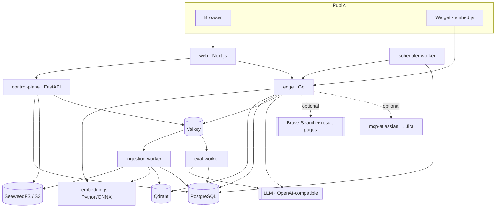
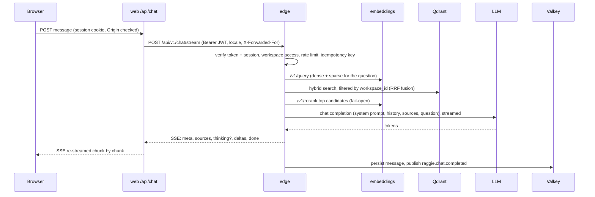
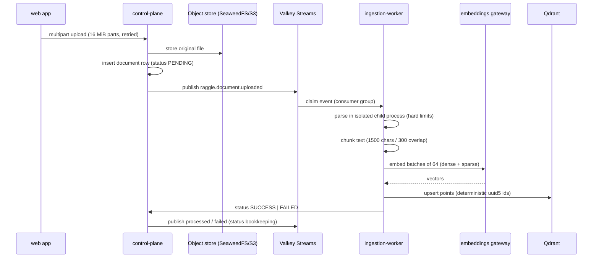

# Architecture

How Raggie is put together, how a question becomes a cited answer, and where each
piece of state lives. This document describes the code as it is; items not yet
implemented are marked **planned**.

- [1. Components](#1-components)
- [2. Chat request flow](#2-chat-request-flow)
- [3. Ingestion flow](#3-ingestion-flow)
- [4. Retrieval](#4-retrieval)
- [5. Answer evaluation](#5-answer-evaluation)
- [6. Events](#6-events)
- [7. Multi-tenancy and data model](#7-multi-tenancy-and-data-model)
- [8. The widget](#8-the-widget)
- [9. Reliability](#9-reliability)
- [10. Deployment topologies](#10-deployment-topologies)
- [11. Contracts between services](#11-contracts-between-services)
- [12. Design targets](#12-design-targets)

## 1. Components



| Component | Language | Responsibilities | Writes |
|---|---|---|---|
| **web** | TypeScript, Next.js (App Router), next-intl TR/EN | Admin console and internal chat UI. Server-side route handlers and server actions call the control plane and the edge with the user's session token; the browser only talks to web. | — (session cookies) |
| **edge** | Go 1.26 | Chat API with SSE streaming, retrieval orchestration (embed → hybrid search → rerank → prompt), bounded LLM pools, widget token issuance and widget chat, conversation history API, web research, MCP tool loop, scheduled-task execution endpoint. | conversations, messages, idempotency keys, events |
| **control-plane** | Python 3.13, FastAPI | Authentication (sessions, refresh rotation, SSO/SCIM APIs), RBAC/ABAC, organizations/teams/workspaces/users, documents and uploads, branding, AI model policy, analytics, audit log. **Single owner of the database schema** (migrations). | everything except chat messages |
| **ingestion-worker** | Python 3.13 | Consumes document events: parse (in an isolated child process), chunk, embed, upsert into Qdrant, purge deleted documents, retry failures with back-off. | document status, Qdrant points |
| **eval-worker** | Python 3.13 | Consumes completed chats and scores faithfulness and citation quality with an LLM judge. | evaluation scores on messages |
| **scheduler-worker** | Python 3.13 | Claims due scheduled tasks (`FOR UPDATE SKIP LOCKED`), runs them through the edge, writes the result to the notifications inbox. | scheduled tasks, notifications |
| **embeddings** | Python 3.13, fastembed / ONNX Runtime | The single embedding gateway: dense and BM25 sparse vectors, reranking, a Valkey query cache; local models by default, optional cloud provider. | — |
| **widget** | vanilla JavaScript (no dependencies) | `embed.js`: Shadow-DOM chat bubble for third-party sites, served by the edge at `/widgets/`. | — |
| **mockllm** | Go | Deterministic OpenAI-compatible LLM for demos and tests (`mock` profile). | — |

Datastores: **PostgreSQL** (system of record), **Qdrant** (vectors, named
`dense` + `bm25` vectors per point), **Valkey** 8 (Redis-protocol compatible:
event streams, caches, rate limits, login lockout; the compose service keeps the
name `redis`, so `REDIS_URL` is unchanged), and an S3-compatible object store for
the original files: **SeaweedFS** is bundled (compose service `objectstore`,
network alias `minio`), and any other S3 service works through the `MINIO_*`
settings (endpoint, credentials, bucket), which are generic S3 settings despite
the name.

## 2. Chat request flow



Details:

- The system prompt is assembled server-side from the workspace prompt, an
  optional skill and a TR/EN RAG template; a client-supplied system prompt is
  ignored.
- History: when the conversation already has stored messages, the edge replays
  up to `HISTORY_MAX_MESSAGES` (16) of them from the database and ignores
  client-sent history. On a new internal conversation the client-sent history
  can seed the first turn, reduced to plain `user`/`assistant` turns (newest 16,
  at most 8,000 characters each; system, tool and other roles are dropped).
  Widget sessions ignore client-sent history entirely.
- Optional context: web research (Brave), personalization (the user's profile)
  and memory (facts remembered from earlier chats) each sit behind a global
  switch and a per-workspace switch. MCP tools need `MCP_ENABLED`, a Jira
  integration connected for the organization, and a model with tool support;
  there is no per-workspace MCP switch. Widget chats never get personalization,
  memory or MCP, and get web research only when `WIDGET_WEB_SEARCH_ENABLED` is
  on (default off) as well as the workspace switch.
- Errors use stable codes (`busy`, `rate_limited`, `draining`, …) with a localized
  message, as JSON before the stream starts or as an SSE `error` event after.

## 3. Ingestion flow

1. The web app uploads the file to the control plane as a multipart upload
   (16 MiB parts, each retried on failure, up to 10 GiB), assembled in the
   object store. An interrupted upload cannot yet be resumed after a page
   reload. API clients can also send files up to 32 MiB in a single request.
2. The control plane stores the document row (status `PENDING`) and publishes
   `raggie.document.uploaded` on Valkey Streams.
3. An ingestion worker claims the event and parses the file in a disposable child
   process with hard limits (timeout, page/cell/shape caps, archive-size check
   before decompression). Supported: PDF (pdfplumber; pages with little or no
   extractable text go through Tesseract OCR, `tur+eng`), DOCX, XLSX, PPTX, TXT, MD, and images via
   OCR.
4. Text is split into heading-aware chunks of **1500 characters with 300
   characters overlap**.
5. Chunks are embedded in batches of 64 (dense + sparse) through the embeddings
   gateway and upserted into Qdrant with deterministic ids
   (`uuid5(document_id:index)`), so re-processing is idempotent; stale chunks from
   an earlier version are removed.
6. Status becomes `SUCCESS`, or `FAILED` with a reason. Failed documents are
   retried by a sweep with exponential back-off (up to `max_retries`, default 3).



Deleting a document soft-deletes its row and publishes
`raggie.document.deleted`; the worker then removes its Qdrant points and its
object from the object store.

## 4. Retrieval

- **Hybrid search:** dense (multilingual-e5-large) and sparse (BM25) prefetch,
  fused with Qdrant's Reciprocal Rank Fusion; dense-only when sparse vectors are
  disabled.
- **Scoping:** every retrieval query from the edge carries a `workspace_id`
  payload filter (or a list of workspaces the user can access, for "all
  workspaces" search); an empty workspace set is refused.
- **Candidates → context:** `RETRIEVE_CANDIDATE_K=80` fused candidates, the top
  `RERANK_CANDIDATE_K` reranked by a cross-encoder (12 in the shipped
  `.env.example` and Helm values; 24 when unset), `RETRIEVE_CONTEXT_K=12`
  chunks into the prompt with a soft cap of 3 per document.
- **Fail-open reranking:** if the reranker errors or times out, the fused order
  is used.
- **Collections:** one collection per embedding profile
  (`raggie_chunks_d1024` for the default model). See [embeddings.md](embeddings.md).

## 5. Answer evaluation

After a chat turn completes (internal or widget), the edge publishes
`raggie.chat.completed`. The eval worker asks an LLM judge (its own bounded
pool, `EVAL_MAX_CONCURRENCY`) to score:

- **faithfulness**: is every claim supported by the retrieved sources?
  (threshold 0.7)
- **citation validity**: do the `[n]` markers point at real sources? (1.0)
- **citation coverage**: are claims cited? (0.6)

Answers below a threshold are listed under *Admin → Flagged*. This is an
**experimental** review aid, not a guarantee: the judge's precision and recall
have not been measured against labelled data. Partial or aborted answers are
not scored. Above `EVAL_QPS_THRESHOLD` only an `EVAL_SAMPLE_RATE` fraction is
scored. When the judge times out or keeps failing (`EVAL_MAX_DELIVERIES`), the
answer is recorded with citation scores only.

## 6. Events

Valkey Streams with consumer groups (`ingestion-workers`, `eval-workers`) provide
at-least-once delivery. Consumers acknowledge after processing; work held by a
crashed consumer is reclaimed with `XAUTOCLAIM`. Handlers are idempotent
(ingestion keyed on the document, evaluation on the message).

| Topic | Producer | Consumer |
|---|---|---|
| `raggie.document.uploaded` | control-plane | ingestion-worker |
| `raggie.document.processed` / `.failed` | ingestion-worker | (status bookkeeping) |
| `raggie.document.deleted` | control-plane | ingestion-worker (purge) |
| `raggie.chat.completed` | edge | eval-worker |

The envelope is specified in [`contracts/events.md`](../contracts/events.md).
A Kafka/Redpanda transport is **planned**. Streams are currently not trimmed
(`MAXLEN` is **planned**).

## 7. Multi-tenancy and data model

```
Organization ─┬─ Team ─┬─ Team (nested, any depth; resolved via team_closure)
              │        └─ Workspace (INTERNAL chat | EXTERNAL widget)
              └─ Users (role: STAFF | WORKSPACE_ADMIN | SUPER_ADMIN, optional platform-admin flag)
```

Main tables: `organizations`, `teams`, `team_closure`, `team_members`,
`workspaces`, `workspace_members`, `users`, `user_identities`, `invites`,
`auth_sessions`, `documents`, `document_folders`, `conversations`, `messages`,
`message_feedback`, `skills`, `skill_versions`, `scheduled_tasks`,
`notifications`, `user_memory`, `integrations`, `departments`, `locations`,
`audit_log`, `system_settings`.

Access decisions combine role and membership: a SUPER_ADMIN manages their own
organization; workspace actions require effective membership (directly or
through any ancestor team); a platform admin manages platform-wide settings
across organizations. The full model, including tests that enforce it on every
route, is in [security-model.md](security-model.md).

Qdrant holds all organizations in one collection per embedding profile;
isolation is a mandatory `workspace_id` filter on every retrieval query from the
edge (tested). The admin vector map in the control plane reads points and
filters them by workspace afterwards; moving that filter into the Qdrant query
is **planned**. PostgreSQL row-level security is **planned**.

## 8. The widget

`widget/embed.js` is a single dependency-free script. It mounts a Shadow-DOM
chat bubble, asks the edge for a short-lived widget token
(`POST /api/v1/widget/token`), and streams answers from
`POST /api/v1/chat/stream`. The token has its own audience (`widget`) and signing
secret, is issued only to origins on the workspace's allow-list and only for
EXTERNAL workspaces, and binds the conversation to an anonymous session id.
Widget tokens are rejected by every admin endpoint of the edge and the control
plane.

## 9. Reliability

- **Load shedding:** each edge replica accepts up to `EDGE_MAX_SSE_CONNECTIONS`
  concurrent chat streams (default 12,500, `0` = unlimited) and bounds concurrent
  upstream LLM calls (`LLMAAS_CHAT_MAX_CONCURRENCY`, or `max_concurrency` per
  provider). Past either limit, new chats get a retryable `busy` error (503 with
  `Retry-After`) before any stream byte, instead of queueing without bound.
- **Bounded upstream pools:** separate concurrency limits for chat and evaluation
  (and per provider with `LLM_MODEL_PROFILES_JSON`), so background scoring cannot
  starve chat.
- **Idempotency:** with Valkey configured, a chat request that repeats an
  `Idempotency-Key` within 10 minutes is rejected with `conflict` (the check is
  skipped if Valkey is unavailable).
- **Graceful drain and resume:** on SIGTERM the edge fails readiness, lets running
  answers finish within `EDGE_SHUTDOWN_DRAIN_SECONDS`, then sends a `reconnect`
  event; clients resume the interrupted answer by message id, without duplicating
  the user's question.
- **Retries:** failed documents are retried with exponential back-off; upstream
  embedding calls retry with jitter and honour `Retry-After`.
- **Degradation:** reranker failure keeps fused order; web search failure falls
  back to documents only; rate limiting fails open if Valkey is unavailable.

## 10. Deployment topologies

| | Docker Compose (`core` profile) | Kubernetes (community preview) |
|---|---|---|
| Use | single server, evaluation, small teams | multi-replica |
| App services | 1 replica each (scale with `--scale`) | Helm chart (`values-single.yaml`, `values-ha.yaml`) or Kustomize overlays; PDBs, NetworkPolicies, autoscaling in prod |
| Event bus | Valkey Streams | Valkey Streams |
| Migrations | control plane at boot (advisory lock) | Helm migration Job, or at boot |

Caddy is the single front door in Compose: it serves the web app and
the public edge paths on one origin, with automatic HTTPS when `RAGGIE_DOMAIN`
is set ([production.md](production.md)). Optional profiles and overlays: `mock`
(mock LLM, `make up-demo`), `ollama` (bundled Ollama, `make up-ollama`, plus a
GPU overlay), `mcp` (mcp-atlassian).

## 11. Contracts between services

| Concern | Source of truth |
|---|---|
| Database schema | `services/control-plane/migrations/*.up.sql`, applied by `raggie_control_plane/db/migrate.py` |
| Event envelopes | [`contracts/events.md`](../contracts/events.md) |
| Embeddings gateway API | [`contracts/embeddings_gateway.schema.json`](../contracts/embeddings_gateway.schema.json) |
| Qdrant collection layout | [`contracts/qdrant_collection.json`](../contracts/qdrant_collection.json) |
| Chunking (1500 / 300, heading ancestry) | worker chunking tests |
| Edge HTTP API authorization | edge and control-plane authorization matrix tests |

There is no protobuf/gRPC layer; services exchange JSON over HTTP and Valkey Streams.

## 12. Design targets

These are the engineering targets the architecture is built for. The
performance rows are **design targets, not measurements**: no benchmark report
has been published yet. The harnesses that will measure them live in
[`bench/`](../bench/), with the methodology in
[`docs/benchmarks/`](benchmarks/README.md).

The IDs (A1–A5) are the names the benchmark docs, `make` targets and harnesses
use.

| ID | Target | Goal | Status |
|---|---|---|---|
| A1 | Time to first login | `docker compose up` → login page in under 45 s, images already pulled | design target; probe `make a1` |
| A2 | Retrieval latency | embedding + hybrid search + context assembly p95 under 200 ms (local embeddings, warm cache) | design target; harness `make bench-a2` |
| A3 | Ingestion | a 50-page text PDF parsed, chunked, embedded and indexed in ≤ 10 s | design target; harness `make bench-a3` |
| A4 | Widget isolation | a widget token can never reach an admin endpoint | enforced and tested (authorization matrix tests in the edge and the control plane) |
| A5 | Concurrency | 50,000 concurrent streams per cluster (the k6 scenario) with TTFB p95 ≤ 1.5 s | design target; harness `make bench-a5`, k6 script `deploy/load/a5_chat_load.js` |
